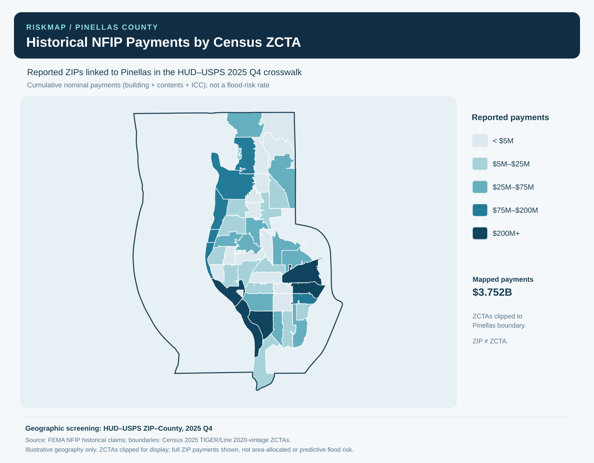

# RiskMap
### Insurance Risk & Geographic Analytics | Python

RiskMap is an ongoing insurance analytics project focused on understanding historical flood insurance claims, geographic loss patterns, and insurance market exposure in Pinellas County, Florida.

The project combines publicly available data from the Federal Emergency Management Agency (FEMA), U.S. Census Bureau, U.S. Department of Housing and Urban Development (HUD), and Florida Office of Insurance Regulation (FLOIR) to explore how historical insurance losses vary across geographic areas.

## Project Objectives

- Analyze historical National Flood Insurance Program (NFIP) claims and payments.
- Identify geographic concentrations of historical flood insurance losses.
- Validate and match ZIP code data with county and Census geographic boundaries.
- Examine historical claim patterns and payment trends.
- Develop interactive visualizations to support insurance analytics and decision-making.
## Geographic Visualization

*Historical NFIP payments across Pinellas County, visualized using Census ZCTA boundaries. These totals represent historical losses, not predicted flood risk.*
## Current Progress

**Phase 1 — Data Collection & Validation (Completed)**

- Collected historical NFIP claims data for Pinellas County.
- Conducted data-quality and geographic consistency checks.
- Matched reported ZIP codes against HUD ZIP-to-county crosswalk data.
- Created historical claims and payment summaries.

**Phase 2 — Geographic Analysis (Completed)**

- Integrated 2025 Census ZIP Code Tabulation Area (ZCTA) boundaries.
- Clipped geographic polygons to Pinellas County boundaries.
- Developed a geographic visualization of historical NFIP claim payments.
- Documented geographic matching limitations and unmatched ZIP codes.

**Phase 3 — Interactive Analytics Dashboard (In Progress)**

Planned features include geographic exploration, historical loss trends, ZIP-level comparisons, and insurance market exposure analysis.

## Technologies & Data Sources

**Technologies:** Python, CSV, Excel, Census geographic data, Shapely, and SVG visualizations.

**Public Data Sources:**
- FEMA — National Flood Insurance Program claims
- U.S. Census Bureau — TIGER/Line geographic boundaries
- HUD — ZIP-to-county crosswalk
- Florida Office of Insurance Regulation — Insurance market data

## Key Findings So Far

- Analyzed approximately 51,800 historical NFIP claim records associated with Pinellas County.
- Identified approximately $3.76 billion in reported historical NFIP payments across the dataset.
- Matched 48 Pinellas-linked ZIP codes to Census ZCTA polygons for geographic visualization.
- Documented unmatched ZIP codes and geographic limitations.

## Limitations

RiskMap currently focuses on historical insurance claims and payments. Historical loss totals do not represent current flood risk, claim probability, or expected future losses.

ZIP codes and Census ZCTAs are not interchangeable geographic units. The county-clipped map is intended for visualization and does not allocate historical payments precisely within county boundaries.

Reported historical payment totals are nominal and have not been adjusted for inflation. Additional exposure data and modeling would be required to estimate insurance risk rates.

## Project Status

**Active Development**

RiskMap is being developed as a portfolio project demonstrating Python programming, data validation, geographic analysis, and insurance analytics. Additional analytical features and visualizations will be added as development continues.
